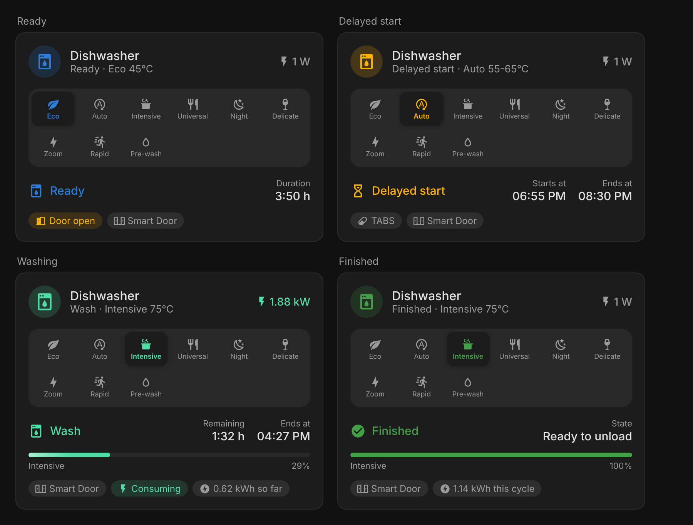
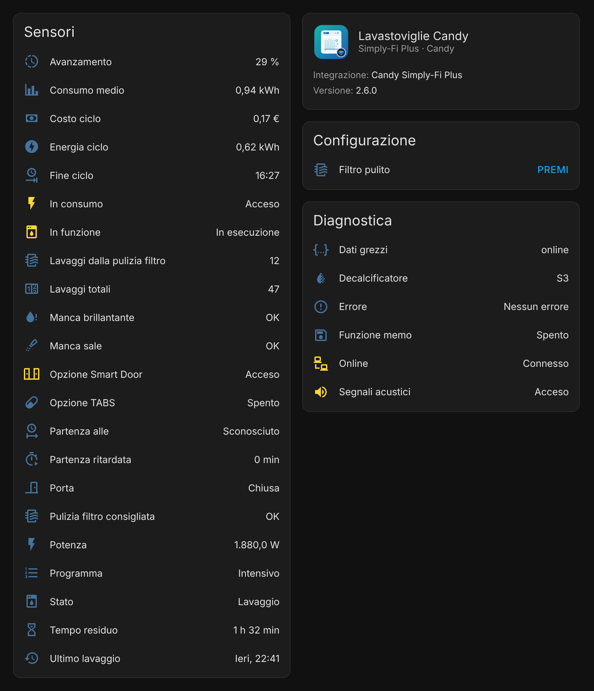
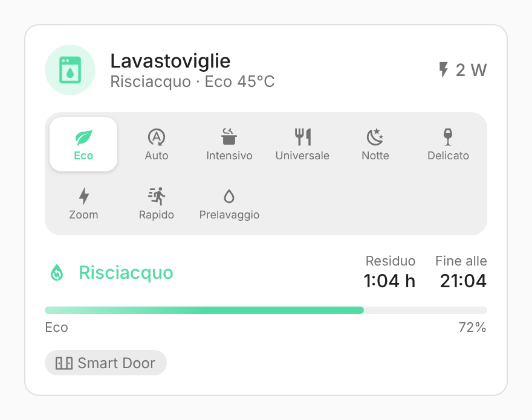

# Candy Simply-Fi Plus

🇮🇹 [Italiano](README.md) · 🇬🇧 **English**

Custom integration for **Home Assistant** that connects **Candy simply-Fi** dishwashers **over the local network**, with no cloud and no Candy account.

It reads the dishwasher status every 30 seconds (adjustable) directly from its WiFi module and shows it in Home Assistant with ready-to-use sensors and a built-in dashboard card. With remote control enabled on the panel it can also **start, schedule and stop** washes.

> ⚠️ Unofficial project, not affiliated with or endorsed by Candy / Haier.

[](https://my.home-assistant.io/redirect/hacs_repository/?owner=ichnusa82&repository=candy-simplyfi-plus&category=integration)



---

## Tested models

| Brand | Model | Product code | App | Status |
|---|---|---|---|---|
| Candy | **CDIMN 4D622PBE** (built-in dishwasher, 15 place settings) | 32901467 | Candy simply-Fi | ✅ Working |

So far Candy Simply-Fi Plus has been tested **on this model only**. Other Candy simply-Fi dishwashers may work, but with different program and state codes (see [How to help](https://github.com/ichnusa82/candy-simplyfi-plus/blob/main/README.en.md#how-to-help)).

**Not compatible:**
- appliances using the **Haier hOn** app: they have no local API;
- simply-Fi **washing machines, dryers and ovens**: they connect, but their fields are different and the sensors would stay empty (support planned).

---

## Features

- 🔌 **Local network only**: no cloud, no account, works without internet
- 🔐 **Automatic encryption handling**: detects whether the dishwasher encrypts its data and recovers the key by itself
- 📊 **Sensors**: wash state and phase, program, remaining time, end time, progress, delayed start, door, salt, rinse aid, options, errors
- 🃏 **Built-in dashboard card**: installed automatically together with the integration
- ⚡ **Energy and cost**: link a power sensor (smart plug, W or kW) to get *Power*, *Consuming*, *Cycle energy* (kWh per wash) and, with the energy price, the *Cycle cost*
- 📈 **Statistics**: total washes and per program, date of the last wash, average consumption per program
- 🧽 **Filter maintenance**: counts washes since the last cleaning and reminds you when it's time; a button resets the counter
- 🔧 **Change IP from the UI**: if the dishwasher gets a new address just use *Reconfigure*, keeping entities and statistics
- 🩺 **Downloadable diagnostics**: a file with data and settings (key and IP hidden) to attach to issues
- ▶️ **Start and stop from Home Assistant**: choose program, TABS, Smart Door and delayed start and start the dishwasher (with remote control enabled on its panel)
- 📝 **Data log**: saves every change to a CSV file, useful to analyse wash cycles
- 🇮🇹 Italian and English interface

---

## Requirements

- Home Assistant **2026.3** or newer (needed for the integration icon; everything else also works on older versions)
- Dishwasher **already connected to WiFi** with the **Candy simply-Fi** app (only needed once)
- Dishwasher and Home Assistant on the **same network**
- Recommended: a **fixed IP** for the dishwasher (DHCP reservation on the router)

---

## Installation

### Marketplace / HACS (recommended)

[](https://my.home-assistant.io/redirect/hacs_repository/?owner=ichnusa82&repository=candy-simplyfi-plus&category=integration)

Press the button above: your Home Assistant opens with the repository ready. Press **Install** and restart.

Or manually:
1. In **Settings → Marketplace** (or HACS before 2026.11) open the **⋮ → Custom repositories** menu.
2. Add `https://github.com/ichnusa82/candy-simplyfi-plus` with type **Integration**.
3. Search for **Candy Simply-Fi Plus**, install it and restart Home Assistant.

### Manual
1. Download the [latest release](https://github.com/ichnusa82/candy-simplyfi-plus/releases) and take the `custom_components/candy_simplyfi_plus` folder.
2. Copy it to `/config/custom_components/candy_simplyfi_plus/`.
3. Restart Home Assistant.

---

## Configuration

1. **Switch the dishwasher on**: when it is off, the WiFi module does not respond.
2. Go to **Settings → Devices & services → Add integration → Candy Simply-Fi Plus**.
3. Enter the dishwasher's **IP address**.
4. Leave the **key** field empty: if the data is encrypted, the key is recovered automatically.

### Changing the IP address
If the dishwasher gets a new IP: **Settings → Devices & services → Candy Simply-Fi Plus → ⋮ → Reconfigure**, enter the new address (with the dishwasher switched on). Entities, statistics and options are kept.

> Tip: give the dishwasher a **fixed IP** (DHCP reservation) in your router.

### Options
In **Candy Simply-Fi Plus → Configure** you can set:

| Option | Description |
|---|---|
| Power sensor | Sensor of the smart plug the dishwasher is plugged into (W or kW) |
| "Consuming" threshold | Value in W above which the dishwasher counts as *consuming* (default 5 W) |
| Energy price (fixed) | Cost of 1 kWh, for the *Cycle cost* sensor |
| Energy price sensor | Alternative to the fixed price, a sensor with the current price (per kWh); if both are set, the sensor wins |
| Clean filter every (washes) | After how many washes to remind you to clean the filter (default 30, 0 = never) |
| Polling interval | How often to read the dishwasher, in seconds (10–300, default 30) |
| CSV data log | Turns the log file on or off (default on) |

With a power sensor configured, **Cycle energy** resets when each wash starts, adds up the kWh used and, at the end of the cycle, keeps the total until the next wash. **Cycle cost** does the same in your currency, using the price valid at each moment of the wash (so it also works with time-of-use tariffs).

Statistics, energy and the filter counter are stored by Home Assistant and **survive restarts**. Only washes that **reach the end of the cycle** are counted (cancelled ones are not).

> Note: during the wash the pump uses very little power; with the default threshold *Consuming* turns on mainly while the dishwasher **heats the water**.

---

## Entities

All entities belong to the **Lavastoviglie Candy** device. Entity names follow the Home Assistant language (Italian or English).



### Sensors
| Entity | Description |
|---|---|
| State | Off, Cancelled, Idle, Ready, Delayed start, Wash, Rinse, Drying, Paused (door opened mid-wash), Finished |
| Program | Program name (attributes: code, temperature, average duration) |
| Remaining time | Minutes to the end of the cycle |
| Cycle end | Expected end time (also with delayed start) |
| Delayed start | Minutes left before the start |
| Starts at | Start time with delayed start |
| Progress | Percentage of the cycle completed |
| Error | Error description (attribute: code) |
| Water softener | Water hardness level set on the dishwasher (S0–S7) (diagnostic) |
| Raw data | Every field read from the dishwasher, as attributes (diagnostic) |
| Power | Only with a power sensor configured |
| Total washes | Completed washes (attributes: number of washes per program) |
| Last wash | Date and time the last wash ended (attributes: program, duration, energy, cost) |
| Washes since filter cleaning | Completed washes since the filter was last cleaned (attribute: date of last cleaning) |
| Cycle energy | kWh used by the running or last finished wash (attributes: program, start, end, duration, outcome). Only with a power sensor configured |
| Cycle cost | Cost of the running or last finished wash. Only with a power sensor and an energy price |
| Average consumption | Average kWh per wash (attributes: average per program, total energy and cost). Only with a power sensor configured |

### Binary sensors
| Entity | Description |
|---|---|
| Running | On while washing |
| Door | Open / closed |
| Salt missing | Salt warning |
| Rinse aid missing | Rinse aid warning |
| TABS option | Combined detergent option active |
| Smart Door option | Automatic door opening active |
| Online | Dishwasher reachable |
| Beeps | Acoustic signals enabled (diagnostic) |
| Memo function | Last program memory enabled (diagnostic) |
| Consuming | Only with a power sensor configured |
| Remote control | On when remote control is enabled on the panel: only then does the dishwasher accept commands |
| Filter cleaning due | Turns on when washes since the last cleaning reach the configured threshold |

### Buttons
| Entity | Description |
|---|---|
| Filter cleaned | Press after cleaning the filter: resets the counter (configuration) |
| Start | Starts the chosen program with the options and delay set |
| Stop | Cancels the running program or the delayed start |

### Settings for the next start
| Entity | Description |
|---|---|
| Program to start | One of the 9 panel programs |
| TABS on next start | Combined detergent option (not used with Pre-wash) |
| Smart Door on next start | Automatic door opening (not used with Zoom, Rapid and Pre-wash) |
| Delayed start on next start | 0 to 23 hours, in half-hour steps (0 = now) |

---

### Using it in automations
*Program*, *Error* and *State* have fixed internal values (e.g. `intensive`, `no_drain`, `finished`) that the UI shows translated. In templates, use `state_translated()` to get the text in your Home Assistant language:

```yaml
{{ state_translated('sensor.lavastoviglie_candy_programma') }}   # → Intensive
{{ states('sensor.lavastoviglie_candy_programma') }}             # → intensive
```

## Remote start

For safety the dishwasher accepts commands **only with remote control enabled on its panel** (Wi-Fi light steady): it confirms that someone loaded it and closed the door. Without it, the *Start* and *Stop* buttons are unavailable and the dishwasher answers `READ ONLY`.

1. Load the dishwasher, close the door and enable **remote control** on the panel.
2. In Home Assistant choose the **Program to start**, the options and any **delayed start**.
3. Press **Start**, from the card, the device page or an automation (e.g. to run in the cheapest tariff hours).

After a command the dishwasher's Wi-Fi module may not answer for 1–3 minutes: this is normal, the wash stays *in progress*.

> A remote **pause** is not available: the dishwasher accepts the command but does not carry it out.

## Dashboard card

The card is loaded automatically by the integration: **no HACS frontend download and no resources to add**.

In **Edit dashboard → Add card** search for **"Candy Simply-Fi Plus"**, or use:

```yaml
type: custom:candy-simplyfi-plus-card
```

Optional settings:

```yaml
type: custom:candy-simplyfi-plus-card
name: Dishwasher             # card title
show_programs: true          # show the program strip
show_dishwasher: true        # stylised dishwasher next to the programs
power_entity: sensor.xxx     # power sensor other than the integration's one
colors:
  active: "#2E7DD7"          # ready
  running: "#52dca5"         # washing
  scheduled: "#FFB300"       # delayed start
  finished: "#43a047"        # finished
```

### Examples

| Dark theme | Light theme |
|---|---|
|  |  |


*Images were generated with sample data.*

The card shows state and phase, the highlighted program, remaining time and end time, an animated progress bar, power, cycle energy and cost, warnings (door open, salt, rinse aid, TABS, Smart Door, errors) and the filter cleaning reminder. With remote control enabled, tap a program to choose it, switch **TABS** and **Smart Door** on or off, set the **delay** with − and + (30-minute steps) and press **Start** (or **Stop** during a wash): the card always asks for confirmation. It follows the Home Assistant light/dark theme and language (Italian or English).

---

## Data log

Every time a value changes, Candy Simply-Fi Plus appends a line to:

```
/config/candy_simplyfi_plus_registro.csv
```

The file is rotated above 2 MB (`candy_simplyfi_plus_registro.old.csv`). It can be deleted at any time: it is recreated automatically. It can be turned off in the **options**.

---

## Protocol codes (CDIMN 4D622PBE)

Found through real tests and the user manual.

### Machine state (`StatoDWash`)
| Code | Meaning |
|---|---|
| 1 | Cancelled / reset in progress (a few seconds, `Program` = P0) |
| 2 | On, no program confirmed |
| 3 | Program started: waiting if `DelayStart` > 0, otherwise washing |
| 4 | Program selected, ready; during a wash it means **paused** (door open) |
| 5 | Cycle finished |
| 7 | Switching off after the end of the cycle (about 1 minute, then the WiFi module goes off) |

### Wash phase (`r2`)
| Code | Phase |
|---|---|
| 0 | Waiting (delayed start) |
| 1 | Pre-wash *(to be confirmed)* |
| 2 | Wash |
| 3 | Rinse |
| 4 | Drying |
| 5 | End |

### Programs (`Program`)
| Code | Panel (`r1`) | Program | Temperature | Duration (manual) | Measured duration | Measured energy |
|---|---|---|---|---|---|---|
| P8 | 1 | Eco | 45 °C | 3:52 | 3:52 | 0.70 kWh |
| P2 | 2 | Intensive | 75 °C | 2:10 | 2:27 * | 1.27 kWh |
| P17 | 3 | Night | 55 °C | 4:00 | — | — |
| P5 | 4 | Universal | 60 °C | 2:00 | 2:21 * | 0.80 kWh |
| P16 | 5 | Auto | 55–65 °C | 1:35 | 2:12–2:16 | 0.92 kWh |
| P9 | 6 | Delicate | 45 °C | 1:25 | — | — |
| P19 | 7 | Zoom | 60 °C | 0:39 | — | — |
| P20 | 8 | Rapid | 50 °C | 0:24 | — | — |
| P12 | 9 | Pre-wash | cold | 0:05 | 0:06 | 0.005 kWh |

\* With **Smart Door** on, programs other than Eco last about **20 minutes longer**. Smart Door opens the door about 1 hour before the end in Eco, and 2 minutes before the end in the other programs. Auto recalculates its duration based on the load.

Values measured on a CDIMN 4D622PBE with a smart plug: they may vary with the load and the water temperature.

### Other fields
| Field | Meaning |
|---|---|
| `RemTime` | Remaining minutes (back to the program duration at the end of the cycle) |
| `DelayStart` | Minutes to the delayed start (in commands it is written in 30-minute steps instead: 1 = 30 min) |
| `OpenDoor` | Door: 1 open, 0 closed |
| `TreinUno` | TABS option |
| `OpenDoorOpt` | Smart Door option |
| `MissSalt` / `MissRinse` | Salt / rinse aid missing |
| `CodiceErrore` | E0 none, E2 no water intake, E3 no drain, E4 water leak, E8/Ei heater or clogged filter |
| `StatoWiFi` | Remote control (CONTROLLO REMOTO on the panel): 1 on, 0 read only |
| `Reset` | 1 for a few seconds after a cancellation (with `StatoDWash` = 1 and `Program` = P0) |
| `r1` | Program number on the panel (Eco 1, Intensive 2, Night 3, Universal 4, Auto 5, Delicate 6, Zoom 7, Rapid 8, Pre-wash 9) |
| `r5` | 1 during the initial phase of the program (about 30 minutes in Eco, 6 in Auto) *(meaning to be confirmed)* |
| `r6` | Beeps: 1 on, 0 off |
| `r7` | Water softener level (S0–S7) |
| `r8` | Memo function: 1 on, 0 off |
| `StartStop` | 0 for washes started on the panel; 1 for washes started remotely (stays 1 until the next command) |

---

## Known limitations

- The dishwasher **switches itself off** after 5 minutes with no program: it then shows as *Off*.
- Remote start, options (TABS, Smart Door), delayed start and stop are verified with **Pre-wash** and **Eco**; the other programs use the same command.
- A remote **pause** does not exist: the dishwasher accepts the command but does not carry it out.
- Program and state codes are verified **on the tested model only**.
- During a wash the WiFi module sometimes stops answering for a few minutes: the wash stays *in progress*. If it does not answer for more than 30 minutes, the wash is considered interrupted.

---

## How to help

Do you own another Candy simply-Fi dishwasher? You can help add it:

1. Install Candy Simply-Fi Plus and run a full wash.
2. Get the file `/config/candy_simplyfi_plus_registro.csv`.
3. Download the diagnostics: **Settings → Devices & services → Candy Simply-Fi Plus → ⋮ → Download diagnostics** (key and IP address are hidden).
4. Open an [issue](https://github.com/ichnusa82/candy-simplyfi-plus/issues) with the **model** (from the rating plate on the door edge), the **program used**, and attach the files.

---

## Credits

- The Home Assistant community for analysing the Candy simply-Fi protocol
- Sk1zZo, for documenting the local start command of Simply-Fi dishwashers (pull request #12 on bigmoby/home-assistant-candy)
- [ofalvai/home-assistant-candy](https://github.com/ofalvai/home-assistant-candy), the integration that paved the way

## Legal notice

### Trademarks
**Candy**, **Simply-Fi**, **hOn**, **Hoover** and **Haier** are registered trademarks of their respective owners (Candy Hoover Group S.r.l. / Haier Group). **Home Assistant** is a trademark of the Open Home Foundation.

These names are used **only to indicate which appliances this software is compatible with**. Their use does not imply any affiliation, sponsorship, endorsement or cooperation by the trademark owners.

**Candy Simply-Fi Plus is an independent, unofficial project.** It is not developed, supported or verified by Candy, Hoover or Haier. For support with the appliance, contact the official customer service only.

### Disclaimer
The software is provided **"as is"**, without warranty of any kind. It works by reading the data the dishwasher makes available on the local network and by sending the commands it accepts with remote control enabled; the protocol is not publicly documented and was reconstructed by observation.

Whoever starts the dishwasher remotely is responsible for having loaded it correctly and for not leaving it running in unsafe conditions.

The author is not liable for malfunctions, damage to the appliance, loss of warranty or any other problem arising from the use of this software.

This project contains no code, firmware or artwork from Candy / Haier.

## License

Released under the [MIT](LICENSE) license.
