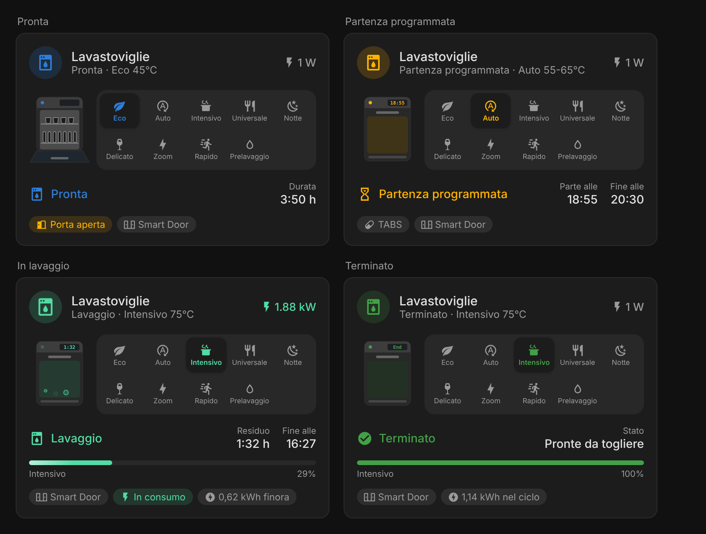
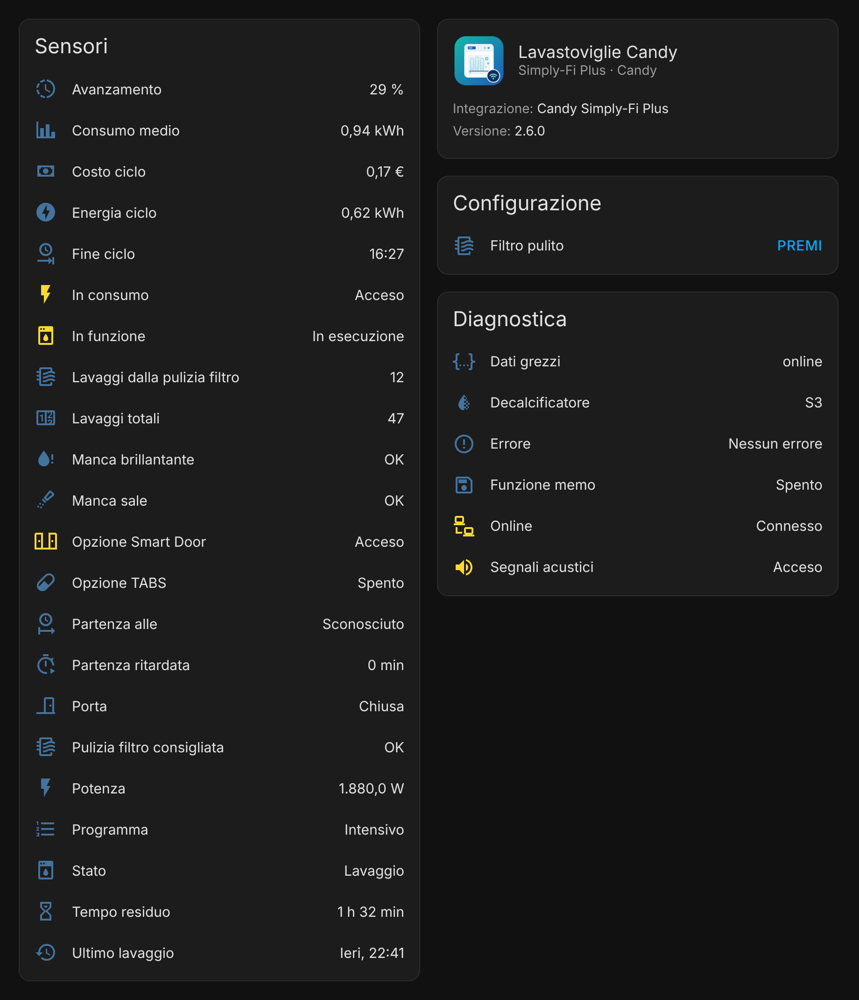
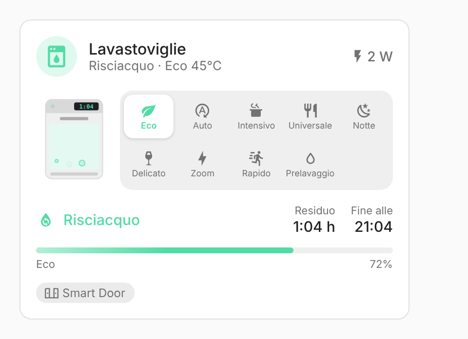
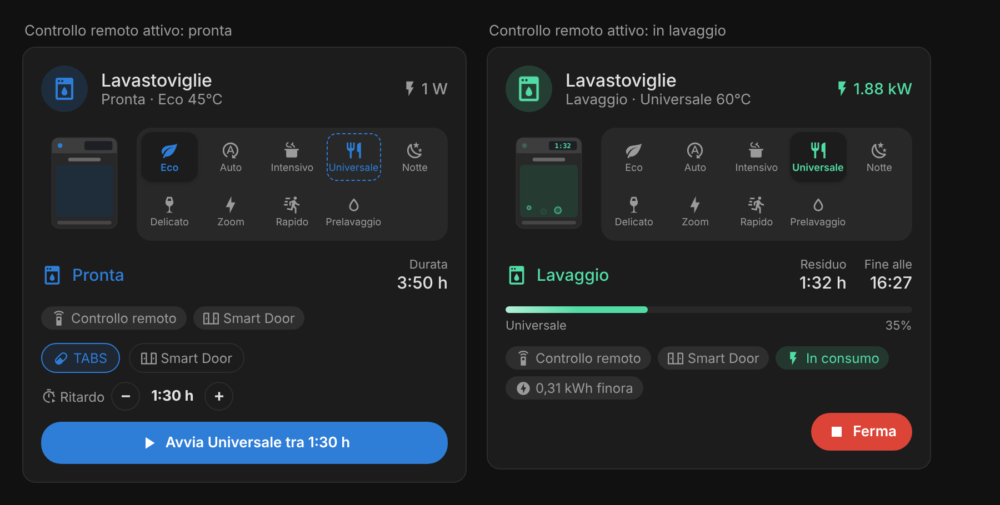

# Candy Simply-Fi Plus

🇮🇹 **Italiano** · 🇬🇧 [English](README.en.md)

Integrazione personalizzata per **Home Assistant** che collega le lavastoviglie **Candy simply-Fi** **in rete locale**, senza cloud e senza account Candy.

Legge lo stato della lavastoviglie ogni 30 secondi (intervallo regolabile) direttamente dal suo modulo WiFi e lo mostra in Home Assistant con sensori pronti all'uso e una card per la dashboard già inclusa. Con il controllo remoto attivo sul pannello permette anche di **avviare, programmare e fermare** i lavaggi.

> ⚠️ Progetto non ufficiale, non affiliato né approvato da Candy / Haier.

[](https://my.home-assistant.io/redirect/hacs_repository/?owner=ichnusa82&repository=candy-simplyfi-plus&category=integration)



---

## Modelli testati

| Marca | Modello | Codice prodotto | App | Stato |
|---|---|---|---|---|
| Candy | **CDIMN 4D622PBE** (lavastoviglie da incasso, 15 coperti) | 32901467 | Candy simply-Fi | ✅ Funzionante |

Al momento Candy Simply-Fi Plus è stata provata **solo su questo modello**. Altre lavastoviglie Candy simply-Fi potrebbero funzionare, ma con codici di programmi e stati diversi (vedi [Come aiutare](https://github.com/ichnusa82/candy-simplyfi-plus#come-aiutare)).

**Non compatibili:**
- apparecchi che usano l'app **Haier hOn**: non hanno l'API locale;
- **lavatrici, asciugatrici e forni** simply-Fi: si collegano, ma i loro campi sono diversi e i sensori resterebbero vuoti (supporto previsto in futuro).

---

## Funzionalità

- 🔌 **Solo rete locale**: nessun cloud, nessun account, funziona anche senza internet
- 🔐 **Cifratura automatica**: riconosce da sola se la lavastoviglie cifra i dati e ne ricava la chiave
- 📊 **Sensori**: stato e fase del lavaggio, programma, tempo residuo, ora di fine, avanzamento, partenza ritardata, porta, sale, brillantante, opzioni, errori
- 🃏 **Card per la dashboard inclusa**: si installa da sola insieme all'integrazione
- ⚡ **Consumi e costo**: collega un sensore di potenza (presa smart, anche in kW) per avere *Potenza*, *In consumo*, *Energia ciclo* (kWh per ogni lavaggio) e, con il prezzo dell'energia, il *Costo ciclo* in €
- 📈 **Statistiche**: lavaggi totali e per programma, data dell'ultimo lavaggio, consumo medio per programma
- 🧽 **Manutenzione filtro**: conta i lavaggi dall'ultima pulizia e avvisa quando è ora di pulirlo; un pulsante azzera il contatore
- 🔧 **Cambio IP da interfaccia**: se la lavastoviglie cambia indirizzo basta *Riconfigura*, senza perdere entità e statistiche
- 🩺 **Diagnostica scaricabile**: un file con dati e impostazioni (chiave e IP nascosti) da allegare alle segnalazioni
- ▶️ **Avvio e arresto da Home Assistant**: scegli programma, TABS, Smart Door e partenza ritardata e avvia la lavastoviglie (con il controllo remoto attivo sul pannello)
- 📝 **Registro dati**: salva ogni cambiamento in un file CSV, utile per analizzare i cicli
- 🇮🇹 Interfaccia in italiano (e inglese)

---

## Requisiti

- Home Assistant **2026.3** o più recente (per l'icona dell'integrazione; le altre funzioni vanno anche su versioni precedenti)
- Lavastoviglie **già collegata al WiFi** con l'app **Candy simply-Fi** (serve solo la prima volta)
- Lavastoviglie e Home Assistant sulla **stessa rete**
- Consigliato: **IP fisso** per la lavastoviglie (prenotazione DHCP sul router)

---

## Installazione

### Marketplace / HACS (consigliato)

[](https://my.home-assistant.io/redirect/hacs_repository/?owner=ichnusa82&repository=candy-simplyfi-plus&category=integration)

Premi il pulsante qui sopra: si apre il tuo Home Assistant con il repository già pronto. Premi **Installa** e riavvia.

Oppure a mano:
1. In **Impostazioni → Marketplace** (o HACS sulle versioni precedenti alla 2026.11) apri il menu **⋮ → Repository personalizzati**.
2. Aggiungi `https://github.com/ichnusa82/candy-simplyfi-plus` con tipo **Integrazione**.
3. Cerca **Candy Simply-Fi Plus**, installala e riavvia Home Assistant.

### Manuale
1. Scarica l'[ultima versione](https://github.com/ichnusa82/candy-simplyfi-plus/releases) e prendi la cartella `custom_components/candy_simplyfi_plus`.
2. Copiala in `/config/custom_components/candy_simplyfi_plus/`.
3. Riavvia Home Assistant.

---

## Configurazione

1. **Accendi la lavastoviglie**: da spenta il modulo WiFi non risponde.
2. Vai in **Impostazioni → Dispositivi e servizi → Aggiungi integrazione → Candy Simply-Fi Plus**.
3. Inserisci l'**indirizzo IP** della lavastoviglie.
4. Lascia vuoto il campo **chiave**: se i dati sono cifrati viene ricavata in automatico.

### Cambiare indirizzo IP
Se la lavastoviglie prende un nuovo IP: **Impostazioni → Dispositivi e servizi → Candy Simply-Fi Plus → ⋮ → Riconfigura**, inserisci il nuovo indirizzo (con la lavastoviglie accesa). Entità, statistiche e opzioni restano invariate.

> Consiglio: assegna alla lavastoviglie un **IP fisso** (prenotazione DHCP) dal router.

### Opzioni
In **Candy Simply-Fi Plus → Configura** puoi scegliere:

| Opzione | Descrizione |
|---|---|
| Sensore di potenza | Sensore della presa smart a cui è collegata la lavastoviglie (W o kW) |
| Soglia "in consumo" | Valore in W sopra il quale la lavastoviglie è considerata *in consumo* (predefinito 5 W) |
| Prezzo energia (fisso) | Costo di 1 kWh, per il sensore *Costo ciclo* |
| Sensore del prezzo energia | In alternativa al prezzo fisso, un sensore con il prezzo attuale (€/kWh); se ci sono entrambi vale il sensore |
| Pulizia filtro ogni (lavaggi) | Dopo quanti lavaggi segnalare la pulizia del filtro (predefinito 30, 0 = mai) |
| Intervallo di lettura | Ogni quanti secondi leggere la lavastoviglie (10–300, predefinito 30) |
| Registro dati CSV | Attiva o disattiva il file di registro (predefinito attivo) |

Con il sensore di potenza configurato, **Energia ciclo** si azzera all'avvio di ogni lavaggio, somma i kWh consumati e a fine ciclo resta sul totale fino al lavaggio successivo. **Costo ciclo** fa lo stesso in euro, usando il prezzo valido in ogni momento del lavaggio (funziona quindi anche con tariffe a fasce).

Statistiche, energia e contatore del filtro sono salvati da Home Assistant e **non si perdono** con i riavvii. Vengono contati solo i lavaggi **arrivati a fine ciclo** (quelli annullati no).

> Nota: durante il lavaggio la pompa consuma pochissimo; con la soglia predefinita *In consumo* si accende soprattutto mentre la lavastoviglie **scalda l'acqua**.

---

## Entità create

Tutte le entità appartengono al dispositivo **Lavastoviglie Candy**.



### Sensori
| Entità | Descrizione |
|---|---|
| Stato | Spenta, Annullato, In attesa, Pronta, Partenza programmata, Lavaggio, Risciacquo, Asciugatura, In pausa (porta aperta a metà lavaggio), Terminato |
| Programma | Nome del programma (attributi: codice, temperatura, durata media) |
| Tempo residuo | Minuti alla fine del ciclo |
| Fine ciclo | Ora prevista di fine (anche con partenza ritardata) |
| Partenza ritardata | Minuti mancanti alla partenza |
| Partenza alle | Ora di partenza con partenza ritardata |
| Avanzamento | Percentuale del ciclo completata |
| Errore | Descrizione dell'errore (attributo: codice) |
| Decalcificatore | Livello di durezza acqua impostato (S0–S7) (diagnostica) |
| Dati grezzi | Tutti i campi letti dalla lavastoviglie come attributi (diagnostica) |
| Potenza | Solo se configurato un sensore di potenza |
| Lavaggi totali | Lavaggi completati (attributi: numero di lavaggi per programma) |
| Ultimo lavaggio | Data e ora di fine dell'ultimo lavaggio (attributi: programma, durata, energia, costo) |
| Lavaggi dalla pulizia filtro | Lavaggi completati dall'ultima pulizia del filtro (attributo: data dell'ultima pulizia) |
| Energia ciclo | kWh consumati dal lavaggio in corso o dall'ultimo terminato (attributi: programma, inizio, fine, durata, esito). Solo se configurato un sensore di potenza |
| Costo ciclo | Costo del lavaggio in corso o dell'ultimo terminato. Solo con sensore di potenza e prezzo dell'energia |
| Consumo medio | kWh medi per lavaggio (attributi: media per programma, energia e costo totali). Solo se configurato un sensore di potenza |

### Sensori binari
| Entità | Descrizione |
|---|---|
| In funzione | Acceso durante il lavaggio |
| Porta | Aperta / chiusa |
| Manca sale | Avviso sale |
| Manca brillantante | Avviso brillantante |
| Opzione TABS | Opzione detersivi combinati attiva |
| Opzione Smart Door | Apertura automatica della porta attiva |
| Online | Lavastoviglie raggiungibile |
| Segnali acustici | Segnali sonori attivi (diagnostica) |
| Funzione memo | Memorizzazione dell'ultimo programma attiva (diagnostica) |
| In consumo | Solo se configurato un sensore di potenza |
| Controllo remoto | Acceso quando il controllo remoto è attivo sul pannello: solo così la lavastoviglie accetta i comandi |
| Pulizia filtro consigliata | Si accende quando i lavaggi dall'ultima pulizia raggiungono la soglia impostata |

### Pulsanti
| Entità | Descrizione |
|---|---|
| Filtro pulito | Da premere dopo aver pulito il filtro: azzera il contatore (configurazione) |
| Avvia | Avvia il programma scelto con le opzioni e il ritardo impostati |
| Ferma | Annulla il programma in corso o la partenza ritardata |

### Comandi per il prossimo avvio
| Entità | Descrizione |
|---|---|
| Programma da avviare | Uno dei 9 programmi del pannello |
| TABS al prossimo avvio | Opzione detersivi combinati (non usata con il Prelavaggio) |
| Smart Door al prossimo avvio | Apertura automatica della porta (non usata con Zoom, Rapido e Prelavaggio) |
| Partenza ritardata al prossimo avvio | Da 0 a 23 ore, a passi di mezz'ora (0 = subito) |

### Uso nelle automazioni
*Programma*, *Errore* e *Stato* hanno valori interni fissi in inglese (es. `intensive`, `no_drain`, `finished`), che l'interfaccia mostra tradotti. Nei template, per avere il testo nella lingua di Home Assistant, usa `state_translated()`:

```yaml
{{ state_translated('sensor.lavastoviglie_candy_programma') }}   # → Intensivo
{{ states('sensor.lavastoviglie_candy_programma') }}             # → intensive
```

## Avvio da remoto

Per sicurezza la lavastoviglie accetta comandi **solo con il controllo remoto attivato dal pannello** (spia Wi-Fi accesa fissa): è la conferma di chi l'ha caricata e ha chiuso la porta. Senza, i pulsanti *Avvia* e *Ferma* non sono disponibili e la lavastoviglie risponde `READ ONLY`.

1. Carica la lavastoviglie, chiudi la porta e attiva il **controllo remoto** dal pannello.
2. In Home Assistant scegli **Programma da avviare**, le opzioni e l'eventuale **partenza ritardata**.
3. Premi **Avvia**, dalla card, dal dispositivo o da un'automazione (es. per partire nella fascia oraria più economica).

Dopo un comando il modulo Wi-Fi della lavastoviglie può non rispondere per 1–3 minuti: è normale, il lavaggio resta *in corso*.

> Una **pausa** da remoto non è disponibile: la lavastoviglie accetta il comando ma non lo esegue.

## Card per la dashboard

La card viene caricata automaticamente dall'integrazione: **non serve HACS né aggiungere risorse**.

In **Modifica dashboard → Aggiungi scheda** cerca **"Candy Simply-Fi Plus"**, oppure usa:

```yaml
type: custom:candy-simplyfi-plus-card
```

Opzioni facoltative:

```yaml
type: custom:candy-simplyfi-plus-card
name: Lavastoviglie          # titolo della card
show_programs: true          # mostra la fila dei programmi
show_dishwasher: true        # lavastoviglie stilizzata accanto ai programmi
power_entity: sensor.xxx     # sensore di potenza diverso da quello dell'integrazione
colors:
  active: "#2E7DD7"          # pronta
  running: "#52dca5"         # in lavaggio
  scheduled: "#FFB300"       # partenza programmata
  finished: "#43a047"        # terminato
```

### Esempi

| Tema scuro | Tema chiaro |
|---|---|
|  |  |



*Le immagini sono state generate con dati di esempio.*

La card mostra stato e fase, programma evidenziato, tempo residuo e ora di fine, barra di avanzamento animata, potenza, energia e costo del ciclo, avvisi (porta aperta, sale, brillantante, TABS, Smart Door, errori) e il promemoria di pulizia del filtro. Con il controllo remoto attivo basta toccare un programma per sceglierlo, attivare o togliere **TABS** e **Smart Door**, regolare il **ritardo** con − e + (a passi di 30 minuti) e premere **Avvia** (o **Ferma** durante il lavaggio): la card chiede sempre conferma. Segue il tema chiaro/scuro e la lingua di Home Assistant (italiano o inglese).

---

## Registro dati

Ogni volta che un valore cambia, Candy Simply-Fi Plus aggiunge una riga a:

```
/config/candy_simplyfi_plus_registro.csv
```

Il file viene ruotato oltre i 2 MB (`candy_simplyfi_plus_registro.old.csv`). Può essere cancellato in qualsiasi momento: viene ricreato da solo. Si può disattivare dalle **opzioni**.

---

## Codici del protocollo (CDIMN 4D622PBE)

Ricavati da prove reali e dal manuale d'uso.

### Stato macchina (`StatoDWash`)
| Codice | Significato |
|---|---|
| 1 | Annullato / reset in corso (pochi secondi, `Program` = P0) |
| 2 | Accesa, nessun programma confermato |
| 3 | Programma avviato: in attesa se `DelayStart` > 0, altrimenti in lavaggio |
| 4 | Programma selezionato, pronta; durante un lavaggio vuol dire **pausa** (porta aperta) |
| 5 | Ciclo terminato |
| 7 | In spegnimento dopo la fine del ciclo (circa 1 minuto, poi il modulo WiFi si spegne) |

### Fase del lavaggio (`r2`)
| Codice | Fase |
|---|---|
| 0 | In attesa (partenza ritardata) |
| 1 | Prelavaggio *(da confermare)* |
| 2 | Lavaggio |
| 3 | Risciacquo |
| 4 | Asciugatura |
| 5 | Fine |

### Programmi (`Program`)
| Codice | Pannello (`r1`) | Programma | Temperatura | Durata (manuale) | Durata misurata | Energia misurata |
|---|---|---|---|---|---|---|
| P8 | 1 | Eco | 45 °C | 3:52 | 3:52 | 0,70 kWh |
| P2 | 2 | Intensivo | 75 °C | 2:10 | 2:27 * | 1,27 kWh |
| P17 | 3 | Notte | 55 °C | 4:00 | — | — |
| P5 | 4 | Universale | 60 °C | 2:00 | 2:21 * | 0,80 kWh |
| P16 | 5 | Auto | 55–65 °C | 1:35 | 2:12–2:16 | 0,92 kWh |
| P9 | 6 | Delicato | 45 °C | 1:25 | — | — |
| P19 | 7 | Zoom | 60 °C | 0:39 | — | — |
| P20 | 8 | Rapido | 50 °C | 0:24 | — | — |
| P12 | 9 | Prelavaggio | fredda | 0:05 | 0:06 | 0,005 kWh |

\* Con lo **Smart Door** attivo i programmi diversi dall'Eco durano circa **20 minuti in più**. Lo Smart Door apre la porta circa 1 ora prima della fine nell'Eco, e 2 minuti prima della fine negli altri programmi. L'Auto ricalcola la durata in base al carico.

Valori misurati su un CDIMN 4D622PBE con una presa smart: possono variare con il carico e la temperatura dell'acqua.

### Altri campi
| Campo | Significato |
|---|---|
| `RemTime` | Minuti residui (a fine ciclo torna alla durata del programma) |
| `DelayStart` | Minuti alla partenza ritardata (nei comandi si scrive invece in passi di 30 minuti: 1 = 30 min) |
| `OpenDoor` | Porta: 1 aperta, 0 chiusa |
| `TreinUno` | Opzione TABS |
| `OpenDoorOpt` | Opzione Smart Door |
| `MissSalt` / `MissRinse` | Mancanza sale / brillantante |
| `CodiceErrore` | E0 nessuno, E2 non carica acqua, E3 non scarica, E4 perdita d'acqua, E8/Ei resistenza o filtro |
| `StatoWiFi` | Controllo remoto (CONTROLLO REMOTO sul pannello): 1 attivo, 0 sola lettura |
| `Reset` | 1 per pochi secondi dopo un annullamento (con `StatoDWash` = 1 e `Program` = P0) |
| `r1` | Numero del programma sul pannello (Eco 1, Intensivo 2, Notte 3, Universale 4, Auto 5, Delicato 6, Zoom 7, Rapido 8, Prelavaggio 9) |
| `r5` | 1 nella fase iniziale del programma (circa 30 minuti nell'Eco, 6 nell'Auto) *(significato da confermare)* |
| `r6` | Segnali acustici: 1 attivi, 0 disattivati |
| `r7` | Livello decalcificatore (S0–S7) |
| `r8` | Funzione memo: 1 attiva, 0 disattivata |
| `StartStop` | 0 con i lavaggi avviati dal pannello; 1 con quelli avviati da remoto (resta 1 fino al comando successivo) |

---

## Limitazioni note

- La lavastoviglie **si spegne da sola** dopo 5 minuti senza programma: in quel caso risulta *Spenta*.
- Avvio, opzioni (TABS, Smart Door), partenza ritardata e arresto da remoto sono verificati con **Prelavaggio** ed **Eco**; gli altri programmi usano lo stesso comando.
- Una **pausa** da remoto non esiste: la lavastoviglie accetta il comando ma non lo esegue.
- I codici di programmi e stati sono verificati **solo sul modello testato**.
- Durante il lavaggio il modulo WiFi a volte non risponde per qualche minuto: il lavaggio resta *in corso*. Se non risponde per più di 30 minuti, il lavaggio viene considerato interrotto.

---

## Come aiutare

Hai un'altra lavastoviglie Candy simply-Fi? Puoi aiutare ad aggiungerla:

1. Installa Candy Simply-Fi Plus e fai un lavaggio completo.
2. Recupera il file `/config/candy_simplyfi_plus_registro.csv`.
3. Scarica la diagnostica: **Impostazioni → Dispositivi e servizi → Candy Simply-Fi Plus → ⋮ → Scarica diagnostica** (chiave e indirizzo IP sono nascosti).
4. Apri una [segnalazione](https://github.com/ichnusa82/candy-simplyfi-plus/issues) indicando **modello** (dalla targhetta sul bordo della porta), **programma usato** e allega i file.

---

## Ringraziamenti

- La community di Home Assistant per il lavoro di analisi sul protocollo Candy simply-Fi
- Sk1zZo, per aver documentato il comando di avvio locale delle lavastoviglie Simply-Fi (proposta n. 12 su bigmoby/home-assistant-candy)
- [ofalvai/home-assistant-candy](https://github.com/ofalvai/home-assistant-candy), integrazione che ha aperto la strada

## Note legali

### Marchi
**Candy**, **Simply-Fi**, **hOn**, **Hoover** e **Haier** sono marchi registrati dei rispettivi proprietari (Candy Hoover Group S.r.l. / Haier Group). **Home Assistant** è un marchio della Open Home Foundation.

Questi nomi sono citati **solo per indicare con quali apparecchi è compatibile** questo software. Il loro uso non implica alcuna affiliazione, sponsorizzazione, approvazione o collaborazione da parte dei titolari dei marchi.

**Candy Simply-Fi Plus è un progetto indipendente e non ufficiale.** Non è sviluppato, supportato né verificato da Candy, Hoover o Haier. Per assistenza sull'apparecchio rivolgersi esclusivamente al servizio clienti ufficiale.

### Esclusione di responsabilità
Il software è fornito **"così com'è"**, senza garanzie di alcun tipo. Funziona leggendo i dati che la lavastoviglie rende disponibili sulla rete locale e inviandole i comandi che accetta con il controllo remoto attivo; il protocollo non è documentato pubblicamente ed è stato ricostruito tramite osservazione.

Chi avvia la lavastoviglie da remoto è responsabile di averla caricata correttamente e di non lasciarla in funzione in condizioni non sicure.

L'autore non è responsabile per malfunzionamenti, danni all'apparecchio, perdita di garanzia o altri problemi derivanti dall'uso del software.

Questo progetto non contiene codice, firmware o materiale grafico di Candy / Haier.

## Licenza

Distribuito con licenza [MIT](LICENSE).
